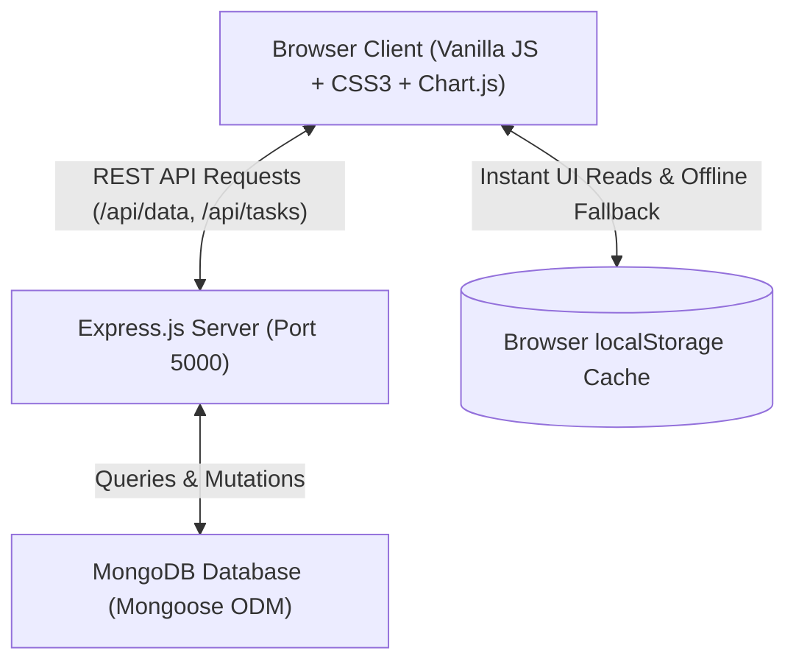

# Career360 — Student Career Roadmap & Placement Readiness Tracker

[](https://nodejs.org/)
[](https://expressjs.com/)
[](https://www.mongodb.com/)
[](https://developer.mozilla.org/)
[](LICENSE)

An end-to-end full-stack placement preparation portal and career roadmap management system designed for engineering students preparing for campus placement drives, technical interviews, and off-campus opportunities.

Developed by **Malathi Durai** ([@malathidurai06](https://github.com/malathidurai06)).

---

## 🏗️ System Architecture

Career360 uses a dual-layer data synchronization architecture:
- **Primary Data Layer**: MongoDB database managed via a Node.js & Express REST API backend using Mongoose models.
- **Offline Resilience Layer**: In-browser `localStorage` cache ensuring instant initial renders and offline functionality even when the database server is temporarily offline.



---

## 🌟 Key Features

### 1. 📊 Real-Time Readiness Dashboard
- **SVG Semi-Circular Readiness Gauge**: Computes your placement readiness score based on task completion across all tracks.
- **Subway Route Map**: Interactive graphical route connecting all 8 core preparation tracks.
- **Smart Preparation Advisor**: Detects lagging categories, highlights pending high-priority topics, and recommends next actions.
- **Daily Check-in & Streak Counter**: Encourages daily preparation with active flame indicators and 30-day consistency analytics.

### 2. 🗺️ Placement Roadmap & Task Manager
- Categorized across **8 core tracks**:
  1. *Aptitude & Logical Reasoning*
  2. *Data Structures & Algorithms (DSA)*
  3. *Programming Languages (C++, Java, Python, JavaScript)*
  4. *Core CS (DBMS, OS, Computer Networks, SQL)*
  5. *Projects & Portfolio*
  6. *Communication & HR Preparation*
  7. *Resume & ATS Optimization*
  8. *Company-Specific Placement Prep*
- Full CRUD task operations with live search, track filtering, priority tags (High, Medium, Low), and status toggling (Pending, In Progress, Done).
- One-click **"Load Starter Roadmap"** with 20+ curated foundational placement topics.

### 3. 🧠 Comprehensive Practice Arena
- **Timed Practice Quizzes**: 5-question multi-topic quizzes with immediate answer feedback and in-depth explanations.
- **3D Revision Flashcards**: Interactive 3D flip cards covering DSA complexities, Core CS definitions, and OOP principles.
- **Mock Interview Simulator**: Built-in 3-minute pitch countdown timer with STAR method prompts and response logger.
- **Test History Log**: Automatically records quiz attempts, scores, and dates.

### 4. 📄 In-Browser ATS Resume Evaluator
- Analyzes pasted resume text against industry keywords for SDE, Data Analyst, and Full-Stack roles.
- Scans for essential engineering keywords, strong action verbs, quantifiable achievements, and section formatting.
- Computes an instant ATS Match Score (0–100) with actionable keyword suggestions.

### 5. 💼 Placement Drives & Company Tracker
- Track campus and off-campus recruitment drives (Google, Amazon, TCS, Infosys, Zoho, etc.).
- Log CTC packages, drive dates, round notes, and hiring stages (*Wishlist*, *Applied*, *Online Assessment*, *Technical Round 1 & 2*, *HR Round*, *Offer Received*, *Rejected*).

### 6. 📈 Visual Analytics & Placement Dossier
- **Chart.js Visualizations**: Weekly task velocity, category completion %, and 14-day momentum trend.
- **Printable Placement Dossier**: Generate a clean, print-ready PDF/paper placement readiness summary for mentors and placement cells.
- **JSON Data Backup & Restore**: Download full data backups or import existing progress files.

### 7. 🎨 Multi-Theme & Unique Dynamic Background System
Customize the visual experience on the fly with instant persistence:
- **6 Premium Color Themes**:
  - 🌌 **Midnight Aurora** (Default) — Deep indigo/violet with glowing amethyst accents
  - ⚡ **Cyber Obsidian** — Pitch-black dark mode with high-contrast neon emerald & cyan
  - 🌊 **Oceanic Sapphire** — Deep abyssal navy with bioluminescent azure & cyan
  - 🌆 **Tokyo Sunset** — Midnight violet with electric fuchsia, magenta & sunset amber
  - ❄️ **Nordic Frost** — Calming arctic slate with cool ice-blue highlights
  - ☀️ **Light Studio** — Crisp pearl white with clean indigo accents and frosted glass
- **4 Unique Background Styles**:
  - 📐 **Matrix Grid** — High-tech engineering dot-matrix and blueprint grid with soft radial vignette
  - 🌟 **Ambient Aurora** — Floating, breathing multi-orbital ambient aurora light beams
  - 🌌 **Cosmic Stars** — Deep-space starfield with subtle starlight constellation gradients
  - 💎 **Clean Minimal** — Distraction-free pure focused background with soft blurred vignette

---

## 🗄️ MongoDB Integration & Database Configuration

Career360 comes with a built-in **MongoDB Database Manager**:
- **Automatic Status Detection**: A live status indicator pill in the header shows `🟢 MongoDB Active` when connected and `🟡 Local Mode` when offline.
- **Dynamic URI Configuration**: Click the database status pill to test and switch between local MongoDB (`mongodb://127.0.0.1:27017/career360`) or **MongoDB Atlas** cloud connection strings (`mongodb+srv://...`) directly from the web interface.
- **One-Click Sync**: Push local progress to MongoDB or reload workspace data from the database at any time.

---

## 🚀 Getting Started & Installation

### Prerequisites
- [Node.js](https://nodejs.org/) (v18 or higher)
- [MongoDB Community Server](https://www.mongodb.com/try/download/community) (optional, if running a local database) OR a free [MongoDB Atlas](https://www.mongodb.com/atlas) cluster URI.

### 1. Clone the Repository
```bash
git clone https://github.com/malathidurai06/Career360-PlacementRoadMap.git
cd Career360-PlacementRoadMap
```

### 2. Install Dependencies
```bash
npm install
```

### 3. Configure Environment Variables
Copy `.env.example` to `.env`:
```bash
cp .env.example .env
```
Default `.env` configuration:
```env
PORT=5000
MONGODB_URI=mongodb://127.0.0.1:27017/career360
```
> **Note**: If you want to use MongoDB Atlas, simply replace `MONGODB_URI` with your connection string:
> `MONGODB_URI=mongodb+srv://<username>:<password>@cluster0.mongodb.net/career360?retryWrites=true&w=majority`

### 4. Start the Application
```bash
npm start
```
For development with auto-reloading:
```bash
npm run dev
```

Open your browser and navigate to:
```
http://localhost:5000
```

---

## 📡 REST API Reference

| Method | Endpoint | Description |
|---|---|---|
| `GET` | `/api/status` | Check MongoDB connection health and database details |
| `GET` | `/api/data` | Fetch current student roadmap document from MongoDB |
| `POST` | `/api/data` | Save/Sync entire user data document to MongoDB |
| `POST` | `/api/tasks` | Add or update a specific task in MongoDB |
| `DELETE` | `/api/tasks/:id` | Remove a task from MongoDB |
| `POST` | `/api/profile` | Update student profile information in MongoDB |
| `POST` | `/api/companies` | Add or update a company drive in MongoDB |
| `DELETE` | `/api/companies/:id` | Delete a company drive entry from MongoDB |
| `POST` | `/api/mongo-config` | Test and switch MongoDB connection URI dynamically |

---

## 📂 Project Directory Structure

```
├── models/
│   └── CareerData.js       # Mongoose Schema & Model for student progress
├── .env.example            # Environment variables template
├── .env                    # Active environment variables
├── index.html              # Core single-page application structure
├── package.json            # Node.js project configuration & dependencies
├── README.md               # Project documentation
├── script.js               # Frontend application logic, SPA router & API sync
├── server.js               # Express REST API backend with MongoDB connection
└── style.css               # Design system, glassmorphism tokens, and themes
```

---

## 👤 Author

**Malathi Durai**
- GitHub: [@malathidurai06](https://github.com/malathidurai06)
- Repository: [Career360-PlacementRoadMap](https://github.com/malathidurai06/Career360-PlacementRoadMap)

---

## 📄 License

This project is licensed under the [MIT License](LICENSE).
